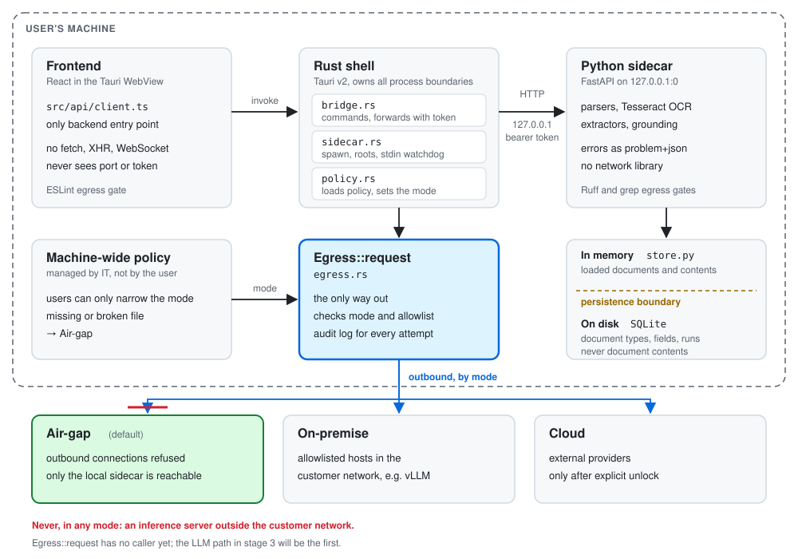

# Substrakt

A cross-platform desktop application that extracts values from invoices,
forms and other business documents, and runs **entirely on your own machine**.
No document content, no model call and no telemetry leaves the customer's
infrastructure.

Target hardware: a standard laptop with 16 GB RAM and **no GPU**.
Target platforms: Windows, macOS, Linux.

> **Status: stage 2 complete, design language v2 in place.** Stage 3, with a
> local LLM via llama.cpp, template recognition and folder watching, is open.
> German is the default interface language; English is available in Settings.
> See the [changelog](CHANGELOG.md).



## Two promises

**Nothing leaves the infrastructure.** This is enforced technically, not by a
settings switch. Outbound traffic can only pass through one function,
`Egress::request` in [`src-tauri/src/egress.rs`](src-tauri/src/egress.rs).
The frontend has no HTTP client and the sidecar no network library. Three
gates (ESLint, Ruff and [`scripts/check-egress.sh`](scripts/check-egress.sh))
enforce this in CI. The default mode is Air-gap; only a machine-wide policy
set by an administrator can open a path into the customer network.

**Fully permissive licences**, for code *and* model weights. No copyleft, no
non-commercial clauses, no licence fees. Enforced through
[`licenses/policy.toml`](licenses/policy.toml): runtime and development
dependencies are checked separately, because only the former is shipped.

## Quick start

Setup is scripted for Linux and WSL2 (Ubuntu 24.04).

```bash
git lfs install --local
npm start          # set up, fetch models, start
```

The first run asks once for `sudo` to install the Tauri system packages,
then installs Rust, uv and Tesseract, downloads the model weights with
SHA-256 checks, and starts the app. Under WSL2, use `npm run app:wsl`. Details
are in [Getting started](docs/getting-started.md).

## How it works

```text
React frontend  ──invoke──▶  Rust shell  ──HTTP 127.0.0.1──▶  Python sidecar
   (no fetch)               (chokepoint)    (bearer token)
```

Three processes, one direction. The frontend knows neither the sidecar's port
nor its session token; every call goes through a Tauri command. The sidecar
parses PDFs, images and spreadsheets, reads scans with Tesseract, extracts
and normalises values, and records for each value where in the document it
was found. Loaded documents stay in memory; SQLite stores only document
types, field definitions and runs. Read more in
[Architecture](docs/architecture/README.md).

What Substrakt knows about a kind of document, such as an invoice, lives in a
YAML file, not in code. See [Document types](docs/document-types.md).

## Four places

Everyday use is automatic, not manual work. The interface has four places:

| Place | Answers |
|---|---|
| Übersicht (Overview) | Is everything running? Do I need to do anything? |
| Prüfen (Review) | These documents were not unambiguous. |
| Vorlagen (Templates) | Which kinds of documents does the program know? |
| Einstellungen (Settings) | Behaviour, privacy, technical details |

The table uses the German defaults. Choose **Einstellungen → Sprache** or
**Settings → Language** to switch the whole interface without restarting.

Users see „Rechnungsnummer“, not `rechnungsnummer: string`, and „nicht
eindeutig“ (not unambiguous), not `0.74`. Confidence values, model names and
technical keys remain available under *Settings → Technical details*. A
colour gate and a word gate keep it that way; the basis is
[`docs/design/design-language.md`](docs/design/design-language.md).

## Not used, on purpose

| Not used | Reason |
|---|---|
| PyMuPDF | AGPL-3.0 |
| OpenCV wheels from PyPI | bundle FFmpeg under LGPL-2.1 |
| python-Levenshtein, fuzzywuzzy | GPL-2.0, also transitively |
| PyTorch | 1.5 to 4 GB for the framework alone; the target has no GPU |
| Mistral OCR | proprietary, paid, no open weights |
| RapidOCR | pulls in opencv-python, and measured worse than Tesseract |
| Gemma models, LFM2, CC-BY-NC checkpoints | no OSI licence |

## Evaluation

[`corpus/evaluation`](corpus/evaluation/README.md) holds a versioned,
synthetic data set for comparing extraction methods: 84 generated PDFs with
separate setup and test parts, expected values and locations, and an offline
scorer. No real documents are included. PDFs are stored in Git LFS.

The archived reports compare Substrakt with Mistral's cloud OCR on this
synthetic corpus. Those comparison scripts called the cloud service from a
developer machine to measure a competitor; they are not part of the
application, which never calls a cloud service.

## Documentation

| | |
|---|---|
| [Getting started](docs/getting-started.md) | installation, first steps |
| [Architecture](docs/architecture/README.md) | processes, egress, persistence, coordinates |
| [Configuration](docs/configuration.md) | operating modes, policy file, directories |
| [Document types](docs/document-types.md) | describing a kind of document in YAML |
| [Development](docs/development.md) | commands, layout, tests |
| [Gates](docs/gates.md) | what CI rejects, and why |
| [Contributing](CONTRIBUTING.md) | how to propose a change |
| [Security](SECURITY.md) | reporting vulnerabilities |

## Licence

[Apache License 2.0](LICENSE). See [NOTICE](NOTICE) for third-party
components and model weights.
